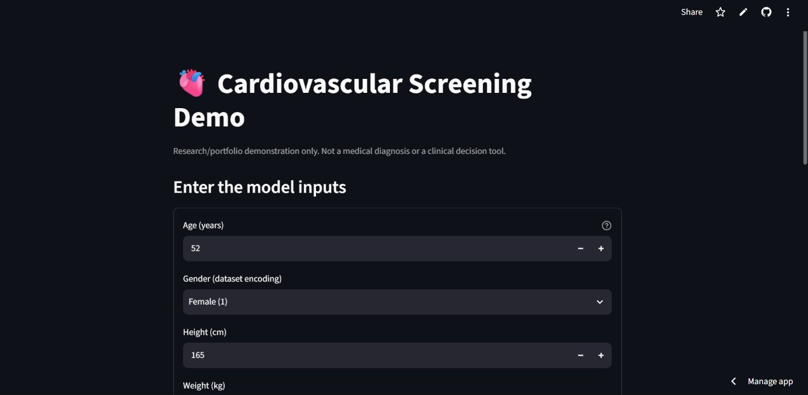
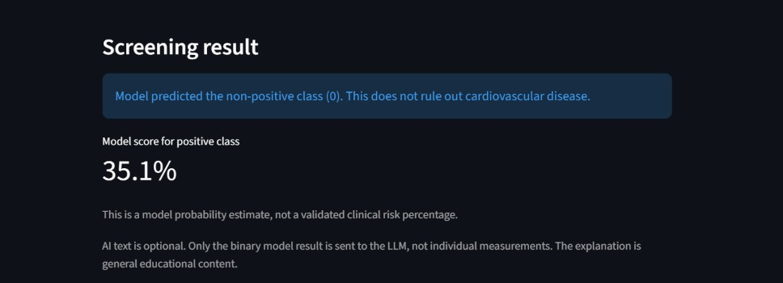
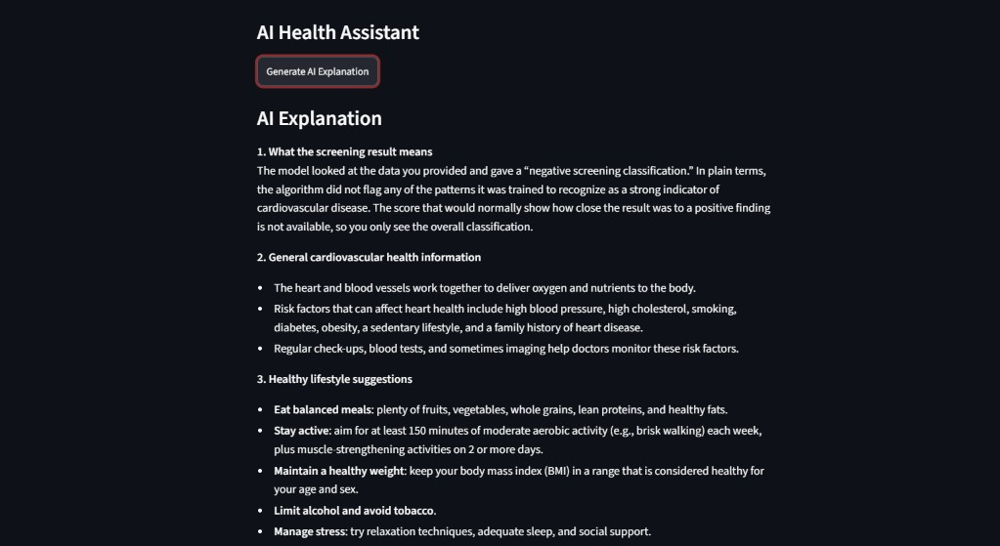
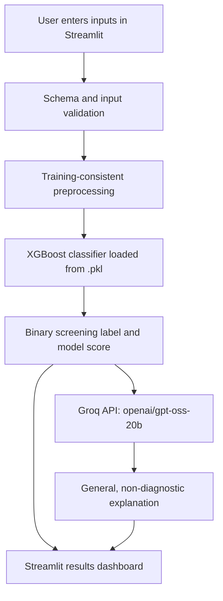

<div align="center">

# 🫀 Cardiovascular Disease Screening with Machine Learning & Generative AI

**An end-to-end machine learning web application combining XGBoost predictions with LLM-powered explanations, built using Python, Streamlit, and Groq.**

[](https://www.python.org/)
[](https://streamlit.io/)
[](https://xgboost.readthedocs.io/)
[](https://groq.com/)
[](#limitations-and-responsible-use)

### 🌐 Live Demo

**[🚀 Try the Web App](https://cardiovascular-ai-app-jxypyomd74atpjvbzmjgzw.streamlit.app/)** · **[📓 View the Training Notebook](https://github.com/afdamdaniel/cardiovascular-ai-app/blob/main/cardiovascular_prediction.ipynb)**


**Research and portfolio demonstration only. Not a medical diagnosis, medical device, or clinical decision-support tool.**

</div>

---

## 📸 Application Preview






## 🎯 Project Overview

This project demonstrates an end-to-end approach to taking a trained machine learning classifier beyond a notebook and turning it into an interactive deployed application.

Users enter cardiovascular-related measurements and lifestyle indicators. A pre-trained **XGBoost classifier** assigns a binary screening class. An optional **Groq-hosted open-weight language model (`openai/gpt-oss-20b`)** then explains that classification in accessible, non-diagnostic language.

### What this project demonstrates

- **Machine learning:** exploratory analysis, input cleaning, model training, evaluation, and model serialization.
- **Model comparison:** Evaluated Logistic Regression and XGBoost on the same held-out test set using accuracy, precision, recall, and F1-score.
- **Hyperparameter tuning:** Applied GridSearchCV to Random Forest using 3-fold cross-validation and 16 hyperparameter combinations, achieving a best CV F1-score of 0.7166.
- **Inference engineering:** loading a saved `.pkl` classifier, preserving feature schema and training-time transformations, and validating input.
- **LLM integration:** using Groq's hosted model to explain the classifier's output without allowing the LLM to overwrite predictions.
- **Python project structure:** separating presentation (`app.py`), prediction (`src/model_service.py`), and generative AI (`src/llm_service.py`).
- **Deployment:** using GitHub and Streamlit Community Cloud with API credentials stored outside source control.

## ✨ Features

| Feature | Implementation |
|---|---|
| Interactive screening form | Streamlit inputs generated from `config/features.json` |
| Binary classification | Saved XGBoost model (`.pkl`) |
| Model score | Positive-class output, when supported by the saved model |
| AI explanation | Groq API with `openai/gpt-oss-20b` |
| State management | Streamlit `st.session_state` preserves result and explanation across reruns |
| Configuration | `.env` locally; Streamlit Cloud Secrets in deployment |
| Safety framing | Non-diagnostic result messaging and urgent-symptom warning |

## 🧠 Model Development and Results

### Data and preparation

The accompanying training notebook uses a tabular cardiovascular dataset with a binary target, `cardio` (0/1). It originally contains **70,000 rows**, and **68,672 rows** remain after blood-pressure filtering.

In the notebook, the data preparation includes:

1. Excluding records with systolic blood pressure outside **60–250 mmHg** or diastolic blood pressure outside **40–200 mmHg**.
2. Requiring systolic pressure (`ap_hi`) to be greater than diastolic pressure (`ap_lo`).
3. Using age in years and transforming the model's age feature with `np.log(age) + 1`.
4. Dropping `id` and `cardio` from the model's input features.
5. Stratified **80/20 train/test split** with `random_state=42`.

The final XGBoost classifier is trained on the 11 features below. Its inputs **are not StandardScaler-transformed** in the training notebook; the separate Logistic Regression experiment uses scaling.

### Input features

| Feature | Meaning |
|---|---|
| `age` | Age in years entered by the user; log-transformed before XGBoost inference |
| `gender` | Encoded gender category (1 or 2) |
| `height` | Height in centimeters |
| `weight` | Weight in kilograms |
| `ap_hi` | Systolic blood pressure (mmHg) |
| `ap_lo` | Diastolic blood pressure (mmHg) |
| `cholesterol` | Encoded cholesterol category (1–3) |
| `gluc` | Encoded glucose category (1–3) |
| `smoke` | Smoking indicator (0/1) |
| `alco` | Alcohol-consumption indicator (0/1) |
| `active` | Physical activity indicator (0/1) |

**Note:** The categorical values are dataset encodings, not clinical laboratory measurements. Model inputs and feature transformations must match training exactly.

### Held-out test performance

These values are reported by the executed classification reports in `cardiovascular_prediction.ipynb`, rather than estimated from the deployed app:

| Metric | Logistic Regression | **XGBoost** |
|---|---:|---:|
| Test accuracy | 72.29% | **73.00%** |
| Positive-class precision | 0.75 | **0.75** |
| Positive-class recall | 0.66 | **0.69** |
| Positive-class F1-score | 0.70 | **0.72** |
| Test observations | 13,735 | 13,735 |

**Why XGBoost?** In this experiment, XGBoost achieved slightly better test accuracy and higher positive-class recall and F1-score, which are informative metrics for a screening-oriented classification exercise. These experimental metrics **do not establish clinical reliability or safety**. Performance may differ on other datasets or real users.


### Random Forest Hyperparameter Tuning (GridSearchCV)

Random Forest was also explored using Scikit-learn's
`GridSearchCV` to optimize model hyperparameters.

The search used:
- **Cross-validation:** 3 folds
- **Parameter combinations:** 16
- **Total model fits:** 48
- **Scoring metric:** F1-score

#### Hyperparameter Search Space

| Parameter | Values |
|---|---|
| `n_estimators` | 100, 200 |
| `max_depth` | 10, 20 |
| `min_samples_split` | 2, 5 |
| `min_samples_leaf` | 1, 2 |

#### Best Hyperparameters

| Parameter | Best Value |
|---|---|
| `n_estimators` | 200 |
| `max_depth` | 10 |
| `min_samples_split` | 5 |
| `min_samples_leaf` | 2 |

**Best Cross-Validation F1-score: 0.7166**

The Random Forest result demonstrates hyperparameter
optimization using cross-validation.

**Note:** This F1-score was obtained through cross-validation
on the training set. It is not directly comparable to the
held-out test scores of Logistic Regression and XGBoost.


### Model artifact

The notebook saves the final classifier to:

```text
cardiovascular_detection_model.pkl
```

The application expects it at:

```text
models/cardiovascular_detection_model.pkl
```

Only load `.pkl` models you created or otherwise trust. Python pickle loading can execute code.

## 🏗️ System Architecture



**Division of responsibilities:** XGBoost predicts. The LLM explains the result for educational purposes. It does not diagnose disease, recalculate clinical risk, or replace the classifier's output. The current design sends only the screening classification to the LLM, not the full feature vector.

## 🗂️ Project Structure

```text
cardiovascular-ai-app/
├── app.py                         # Streamlit user interface
├── requirements.txt               # Python dependencies
├── .gitignore                     # Excludes secrets and local virtual environments
├── .env.example                   # Optional template; no actual credentials
├── config/
│   └── features.json              # Exact model feature schema and UI controls
├── models/
│   └── cardiovascular_detection_model.pkl
├── src/
│   ├── __init__.py                # Package marker
│   ├── model_service.py           # Model load, preprocessing, prediction
│   └── llm_service.py             # Groq explanation generation
├── assets/                        # Add screenshots here
│   └── app-preview.png
└── cardiovascular_prediction.ipynb # Training notebook, if published
```

## ⚙️ Run Locally

### Prerequisites

- Python and pip, with versions compatible with your saved XGBoost model. The local development environment shown during this project used Python 3.13.
- A Groq API key from [GroqCloud](https://console.groq.com/keys) for the optional AI explanation feature.
- Your own trusted trained model at `models/cardiovascular_detection_model.pkl`.

### 1. Clone the repository

```bash
git clone https://github.com/YOUR_USERNAME/cardiovascular-ai-app.git
cd cardiovascular-ai-app
```

Replace `YOUR_USERNAME` with your GitHub username.

### 2. Create and activate a virtual environment

Windows PowerShell:

```powershell
py -3.13 -m venv .venv
.\.venv\Scripts\Activate.ps1
```

macOS or Linux, using a compatible installed Python:

```bash
python3 -m venv .venv
source .venv/bin/activate
```

### 3. Install dependencies

```bash
python -m pip install -r requirements.txt
```

`requirements.txt` should include `streamlit`, `numpy`, `pandas`, `scikit-learn`, `xgboost`, `joblib`, `groq`, and `python-dotenv`. For reliable deployments, pin tested package versions, especially when loading pickled models.

### 4. Configure the API key locally

Create `.env` in the project root (beside `app.py`, **not** inside `.venv`):

```dotenv
GROQ_API_KEY=your_groq_api_key_here
GROQ_MODEL=openai/gpt-oss-20b
MODEL_PATH=models/cardiovascular_detection_model.pkl
POSITIVE_LABEL=1
```

Do not commit `.env`. Ensure `.gitignore` excludes `.env`, `.venv/`, `__pycache__/`, and `.streamlit/secrets.toml`.

### 5. Check the model and feature schema

Verify the file exists at `models/cardiovascular_detection_model.pkl`. Ensure `config/features.json` matches the 11 feature names, data types, order, ranges, and encodings used during training. The model service must apply the exact age transformation from the notebook. If an environment variable `MODEL_PATH` points elsewhere, update it accordingly.

### 6. Start Streamlit

```bash
streamlit run app.py
```

Open the local address printed by Streamlit, commonly `http://localhost:8501`.

### 7. Try a demo screening

1. Enter measurements and categorical selections in the form.
2. Click **Run screening**.
3. Review the binary label and any available positive-class model score.
4. Click **Generate AI Explanation** to request an educational explanation from Groq.

Do not enter identifiable patient information or interpret outputs as clinical advice.

## ☁️ Deploy on Streamlit Community Cloud

1. Push `app.py`, `src/`, `config/features.json`, `requirements.txt`, and the required trusted model artifact to GitHub. Do **not** push `.env`, local environments, or API keys.
2. Open [Streamlit Community Cloud](https://share.streamlit.io/) and create an app from your GitHub repository.
3. Select your repository, the correct branch (for example `main`), and `app.py` as the entrypoint.
4. Select a Python version compatible with your trained model and installed dependencies.
5. In your app's **Secrets** settings, add:

   ```toml
   GROQ_API_KEY = "your_actual_groq_api_key"
   GROQ_MODEL = "openai/gpt-oss-20b"
   ```

6. Ensure `src/llm_service.py` reads credentials from Streamlit Secrets when a local environment variable is unavailable.
7. Deploy and test both the **Run screening** and **Generate AI Explanation** buttons.
8. Replace the **Live Demo** link near the top of this README with your real Streamlit URL.

**Common deployment issues**

| Symptom | Check |
|---|---|
| `Model file not found` | Commit the `.pkl` file under `models/` and match `MODEL_PATH` exactly, including spelling and case |
| `GROQ_API_KEY is missing` | Configure Cloud Secrets and ensure your code reads them |
| Model loading / import error | Install `xgboost` and align dependency versions with the training environment |
| Groq `model_not_found` | Verify that `GROQ_MODEL` is available to your Groq account |
| App works locally but not in cloud | Check Streamlit Cloud logs, secrets, Python version, working paths, and committed files |

## 🔐 Security and Privacy

- Keep API keys exclusively in local environment variables or your hosting provider's Secrets manager.
- Never commit `.env`, `.streamlit/secrets.toml`, or other credentials.
- The present LLM prompt uses the model's binary outcome rather than users' individual measurements, minimizing health-data transmission.
- Groq is an **external hosted API**, not an on-device model. Review its service and data handling terms before exposing the app to users.
- Avoid collecting names, contact information, or storing identifiable health records for this demonstration.
- Treat serialized model artifacts as trusted executable inputs and never load untrusted pickle files.

## ⚠️ Limitations and Responsible Use

- This is a **student/portfolio prototype**, not a clinical screening service or validated medical product.
- A positive classification does not confirm cardiovascular disease. A negative classification does not rule it out.
- A model's `predict_proba` output is not automatically a clinically calibrated risk estimate.
- Dataset encodings, demographic representation, missing data, and distribution shifts may affect predictions.
- LLM explanations may contain errors. They are constrained to general information, not diagnoses or medical treatment recommendations.
- Anyone experiencing chest pain, severe shortness of breath, fainting, or another medical emergency should seek urgent medical attention instead of relying on this app.

## 🛣️ Future Improvements

- Add automated tests for preprocessing, feature order, prediction outputs, and error handling.
- Add stricter validation and user-friendly error messages for abnormal measurement inputs.
- Introduce model calibration and external validation before making any meaningful risk claims.
- Add explainability methods (such as SHAP) with careful interpretation and appropriate limitations.
- Add CI checks for Python formatting and tests.
- Improve accessibility and mobile responsiveness in the Streamlit interface.

## 👨‍💻 Portfolio Notes

This project illustrates the practical workflow from **data preparation → supervised model evaluation → model serialization → application architecture → hosted LLM integration → cloud deployment**. It is intended to demonstrate hands-on Python, ML engineering, inference integration, API use, and reproducible project organization for data science, machine learning, and AI engineering internship applications.

---

<div align="center">

**Built with Python · XGBoost · Streamlit · Groq**

⭐ If you find this project useful, feel free to star the repository.

</div>
